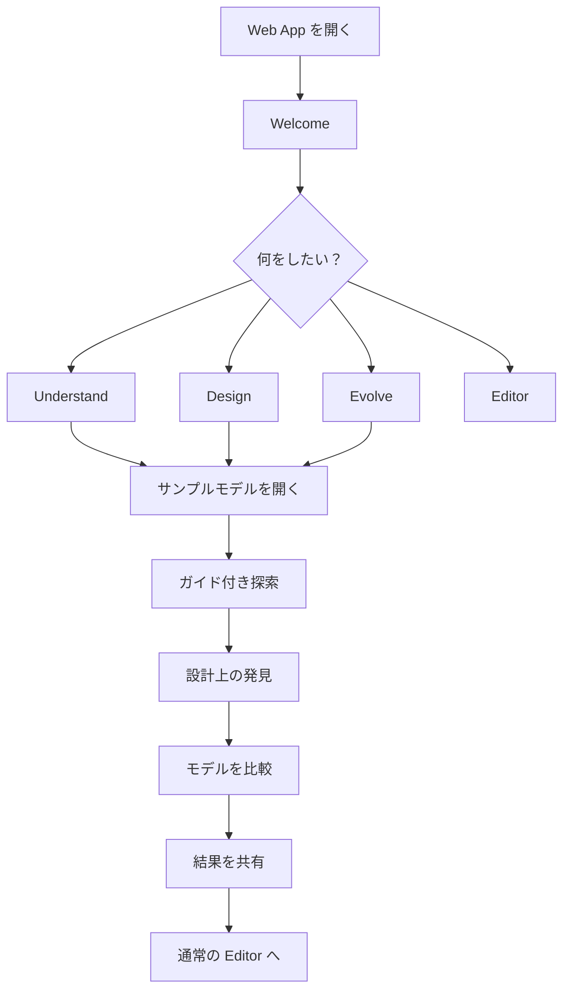

# 初回体験: Shared Architecture Understanding

- **日付**: 2026-11-03
- **種別**: PRD（製品要件・方針）。ADR にはせず、要件を Issue に展開する。
- **ステータス**: Phase 1 を Issue に展開済み。Phase 2 / 3 は Phase 1 の利用を見てから起票する。
- **対象**: karasu Web App（karasu.kompiro.dev）
- **関連**:
  - 展開先 Epic: [#3563](https://github.com/kompiro/karasu/issues/3563)（`epic: first-run`）。スライス A [#3564](https://github.com/kompiro/karasu/issues/3564)（サンプル）/ B [#3565](https://github.com/kompiro/karasu/issues/3565)（Welcome）/ C [#3566](https://github.com/kompiro/karasu/issues/3566)（ガイドパネル）
  - 上位の方針: [`docs/prd/keystone-primary-path.md`](keystone-primary-path.md)（目的関数 = adoption）
  - roadmap: [§実行中の柱](../roadmap.md#実行中の柱テーマ--epic-issue--epic-ラベル)

**目標**: 初回訪問から 5 分以内に、チームでアーキテクチャを共有・議論する価値を体験してもらう。

---

## 1. 背景

karasu は、システムの論理構造・物理構造・組織構造をモデル化し、複数の視点から可視化できる Architecture as Code ツールである。複数ファイルによる分散管理、リバースアーキテクチャ、構造差分、移行状態の表現など、アーキテクチャの進化を支える機能も備えている。

しかし、初回訪問者がこれらの機能を理解し、実際のチーム開発にどう役立つかを判断するには、一定の学習が必要になる。

karasu の本質的な価値は図の生成そのものではない。**関係者が同じシステム構造を見渡し、認識の違いを発見し、チームとしてより良い意思決定を行えること**にある。初回体験では、機能を網羅的に説明するのではなく、この価値を短時間で体験してもらう。

## 2. 価値提案

### メインメッセージ

**Build a shared understanding of your architecture.**
Explore your system, align your team, and evolve your architecture together.

**システムの構造を共有し、チームでより良い設計判断を。**
現状を理解し、将来像を描き、変化を追いながら、チームの共通理解を育てる。

### 伝えたい 3 つの価値

1. **Understand**: 複雑なシステムを複数の視点から理解する。
2. **Align**: 関係者が同じモデルを参照し、認識を合わせる。
3. **Evolve**: 計画と実態を比較しながら、システムを進化させる。

AI はモデルの生成・分析を支援するが、最終的な判断はチームが行う。

## 3. 対象ユーザー

### Primary: Software Architect / Tech Lead

複数のサービスやドメインにまたがる設計判断を担当する。

- システム全体の構造を把握したい。
- サービス分割や責任境界を検討したい。
- 設計案をチームに説明したい。
- 設計と実装の差を追跡したい。

### Secondary: Development Lead

既存システムの構造を分析し、開発チームの理解を深めたい。

- 既存コードから構造を把握したい。
- 他チームとの依存関係を確認したい。
- 新しいメンバーに構造を説明したい。
- モデルを継続的に更新したい。

### 初回体験の前提

DSL の知識、GitHub アカウント、インストール、ユーザー自身のリポジトリは不要。既存のサンプルモデルを使い、最初から AI の利用を要求しない。

## 4. 体験設計の原則

- **Show, don't explain**: DSL の構文を説明する前に、実際のシステム構造を見せる。
- **Start from a real problem**: 機能一覧ではなく、ユーザーが直面する設計課題から始める。
- **Progressive disclosure**: 必要なタイミングで必要な操作だけを案内する。
- **Preserve user control**: チュートリアルはいつでもスキップでき、通常のエディタ操作を妨げない。
- **Collaboration without accounts**: 共有できる成果物を、アカウント登録なしで作れる。
- **Reuse existing capabilities**: 可視化・モデル編集・複数ファイル・差分表示など既存機能を組み合わせ、新規開発を最小にする。

---

## 5. 初回ユーザーフロー



初期実装では 3 つの入口をすべて作り込まない。**Design a service split を最初の完成された体験として実装し、他の入口は既存サンプルにつなぐ。**

## 6. Welcome

**目的**: karasu の用途を 10 秒以内に理解してもらう。

```text
┌───────────────────────────────────────────┐
│     Build a shared understanding          │
│         of your architecture.             │
│                                           │
│   Explore your system, align your team,   │
│   and evolve your architecture together.  │
│                                           │
│   What would you like to do?              │
│  ┌─────────────────────────────────────┐  │
│  │ Design a service split   (guided)   │  │
│  │ Explore boundaries and ownership    │  │
│  └─────────────────────────────────────┘  │
│  ┌─────────────────────────────────────┐  │
│  │ Understand an existing system       │  │
│  └─────────────────────────────────────┘  │
│  ┌─────────────────────────────────────┐  │
│  │ Track architecture evolution        │  │
│  └─────────────────────────────────────┘  │
│              Open the editor              │
└───────────────────────────────────────────┘
```

### 要件

- 初回訪問時に表示する。既存ユーザーは通常のエディタに直接戻れる。
- スキップできる。
- 各選択肢から適切なサンプルを読み込む。
- 編集中のモデルを破棄しない（サンプルは新しいプロジェクトとして作る）。
- 表示有無はローカルに保持してよい。

### 非目標

アカウント登録、チーム作成、リポジトリ接続、AI モデル選択、DSL チュートリアル。

---

## 7. メインシナリオ: Design a Service Split

架空の EC システムを題材とする。注文と請求が単一のサービスに同居しており、チームは請求を独立したサービスへ分割することを検討している。ただし、データベースの共有、サービス間依存、チームの責任範囲に課題がある。ユーザーは karasu で現状を把握し、将来の構造を検討する。

| Step | 目標時間 | ガイドの問いかけ | ユーザー操作 | 期待する発見 |
| --- | --- | --- | --- | --- |
| 1. Explore the current architecture | 60 秒 | This is your current system. Select a component to inspect its relationships. | ドメインとサービスを選択し、ドリルダウンする | 注文と請求は別ドメインだが、同じサービスに実装されている |
| 2. Discover organizational boundaries | 45 秒 | Switch to the organization view to see which teams own each part. | Org ビューでチームの所有範囲とチーム間依存を見る | サービスの境界とチームの責任範囲が一致していない |
| 3. Explore the target architecture | 60 秒 | What if Billing became an independent service? | 計画モデルを開き、現状との構造差分を見る | 分割するだけでは、データの所有権やチーム間依存は解決しない |
| 4. Make a design decision | 60 秒 | Discuss what should change now, what can wait, and which dependencies remain. | 移行途中の構造と `@planned` などの状態を見る | モデルは完成形だけでなく、選択肢や移行過程を議論するために使える |
| 5. Share your understanding | 45 秒 | Share this model with your team and continue the discussion. | 共有リンクを作る、SVG をエクスポートする | この構造を見せながら設計議論ができる |

Step 4 で提示する問い:

- Billing Service の独立は何を改善するのか？
- 共有 DB を一時的に残してもよいか？
- どのチームが移行を担当するのか？
- どの状態になれば移行完了と言えるか？

karasu が設計上の正解を提示する必要はない。**モデルを見た関係者が、適切な問いを立てられることを重視する。**

完了時は "You have explored an architecture decision with karasu." と、次にできること（自分のシステムを探索する、目標アーキテクチャを作る、変更を比較する、チームと共有する）を示し、**Continue to editor** で通常のエディタへ移る。

### 実装上の制約

- 現状・計画・移行途中のモデルは事前に用意する。
- 差分はアプリ既存の差分モード（ファイル同士の比較）を使う。差分を見せるためだけに新しい比較エンジンを作らない。

## 8. 進行 UI

連続するモーダルではなく、画面の一部に固定するコンパクトなパネルにする。

```text
┌──────────────────────────────────────────┐
│ Explore architecture              2 / 5  │
│ ━━━━━━━━━━━━━━━░░░░░░░░░░░░░░░░░░░░░░░░ │
│ Discover organizational boundaries       │
│ Switch to Org view and explore how       │
│ teams own the system.                    │
│ Skip tour             ← Back    Next →   │
└──────────────────────────────────────────┘
```

- いつでもスキップでき、戻れる。
- ユーザー操作をブロックしない。ビュー切り替えは既存の仕組みを使う。
- 現在のステップを明示する。
- 完了後は通常のエディタへ移る。

ユーザーの操作完了を検知して次へ進める案内は Phase 2 とし、Phase 1 は手動の Next でよい。

## 9. サンプルモデル

| 種類 | 要素 |
| --- | --- |
| Domains | Ordering / Billing / Inventory |
| Services | Commerce Application / Billing Service（計画）/ Inventory Worker |
| Data | Commerce Database / Billing Database（計画） |
| Teams | Commerce Team / Platform Team / Billing Team |
| States | Current / Planned / Migrating |

条件: 複雑すぎず 1 画面で主要構造を把握できる。論理・物理・組織の視点を切り替えられる。現状と計画に意味のある差分があり、チーム間依存と移行途中の構造を表現できる。**最初の理解に必要な複雑さだけを持たせる。**

### karasu の仕様に合わせた構成

提案時の「状態ごとに system / domains / services / organization の 4 ファイル」は概念案で、実装では次の形にした。

- 1 つのプロジェクトに 3 つの入口ファイルを置く: `index.krs`（Current）、`planned.krs`（Planned）、`migrating.krs`（Migrating）。各ステップがファイル 1 つの切り替えで済み、差分モードが 2 ファイルをそのまま比べられる。
- 移行途中の状態は既存のライフサイクル注釈で表す: `@planned`（まだ無い）、`@migration_target(from: …)`（移行先）、`@deprecated`（移行元）。`@migrating` という注釈は無く、追加もしない（新しい DSL 構文は非目標）。

---

## 10. 通常の Editor への接続

初回体験は独立したデモで終わらせない。完了後、同じモデルを通常のエディタで編集できる。DSL の編集、サービスの追加、チームの責任範囲の変更、別ビューでの確認、自分のモデルの読み込み、変更の共有はこの段階で案内する。

AI は初回体験の必須要素にしない。ユーザーが自分のシステムをモデル化したい段階で案内する。**AI はモデルを作るための手段であり、チームの共通理解がプロダクトの目的である。**

## 11. 実装スコープ

### Phase 1: 最小実装（Epic [#3563](https://github.com/kompiro/karasu/issues/3563)）

既存機能を組み合わせて、サービス分割の体験を提供する。

- Welcome 画面と 3 つの入口（[#3565](https://github.com/kompiro/karasu/issues/3565)）
- Current / Planned / Migrating のサンプル（[#3564](https://github.com/kompiro/karasu/issues/3564)）
- 5 ステップのガイド、既存ビューとの連携、共有操作への誘導、Skip / Continue to editor（[#3566](https://github.com/kompiro/karasu/issues/3566)）

作らないもの: 独自の共同編集、コメント、ユーザーアカウント、新しいモデル比較エンジン、新しい DSL 構文、AI による設計判断の自動化。

### Phase 2: 体験改善（Phase 1 の利用状況を見て起票する）

- ガイドの操作完了の自動検知
- サンプルの切り替え
- Understand / Evolve シナリオの充実
- 共有先から戻った際の文脈維持
- 初回体験の再実行（Phase 1 ではコマンドパレットから Welcome を開き直せる）

### Phase 3: チーム利用の検証

実際の開発チームでの利用テスト、共有後の議論の観察、認識の違いが発見された事例の収集、モデル更新負担の調査、継続利用を妨げる要因の特定。

---

## 12. 成功指標

| 指標 | 初期目標（仮説） |
| --- | --- |
| Welcome からデモ開始 | 40% 以上 |
| デモ完了率 | 50% 以上 |
| 完了までの中央値 | 5 分以内 |
| 2 種類以上のビューを閲覧 | 70% 以上 |
| 共有操作の実行 | 20% 以上 |

これらは実測値ではなく初期の検証目標である。**アプリはテレメトリを持たないため、現状ではこの数値を計測できない。** Phase 1 では計測を足さず、計測の要否は別途判断する。それまでは下のインタビューが主な信号になる。

### インタビュー質問

1. karasu を使って、これまで気づいていなかったシステムの関係に気づいたか？
2. このモデルを同僚と共有したいと思ったか？
3. 普段使っている Mermaid、Miro、LikeC4 などと何が違ったか？
4. 自分のシステムをモデル化する負担に見合う価値があるか？
5. 次の設計レビューで使いたいと思うか？

特に重視するのは、**チームで使いたいと思った具体的な理由**である。

## 13. リスクと対策

| リスク | 対策 |
| --- | --- |
| チュートリアルが長い | 5 分以内、常時スキップ可能 |
| 機能説明に偏る | 設計課題と発見を中心にする |
| サンプルが単純すぎる | チーム間依存と移行状態を含める |
| サンプルが複雑すぎる | 主要要素に絞る |
| DSL 学習が障壁になる | 初回体験では編集を必須にしない |
| 比較機能の Web 統合が重い | アプリ既存の差分モードを使う（統合済み） |
| 共有リンクが大きくなる | 既存の共有はリンク全体を fragment に持ち、サーバーに送る OGP 用 URL だけが上限を持つ（超えると fragment だけのリンクになる） |
| 既存ユーザーの操作を妨げる | Welcome は既定プロジェクトを作った初回起動だけに出し、deep link や共有リンクでは出さない |
| チームでの価値が伝わらない | 議論すべき設計上の問いを提示する |

## 14. 受け入れ条件

- 初回訪問者が karasu の用途を理解できる。
- DSL を書かずにデモを開始できる。
- System / Org など複数視点を体験できる。
- 現状と将来計画の違いを確認できる。
- サービス分割の設計上の論点を理解できる。
- モデルを共有する方法が分かる。
- 5 分以内で主要体験を完了できる。
- チュートリアルをスキップできる。
- 通常のエディタに戻れる。
- 既存ユーザーの操作を妨げない。

## 15. 非目標

karasu の全機能の説明、DSL の完全な習得、設計上の正解の提示、AI による意思決定の代行、新しい共同編集プラットフォームの構築、競合製品の全機能の再現。

初回体験の役割は、**ユーザーに次の行動を起こす理由を与えること**である。

## 16. 実現したい体験

> これは単にアーキテクチャ図を作るツールではない。
> 今のシステムがどうなっていて、将来どうしたいのかをチームで共有できる。
> サービス分割や移行の議論で使えそうだ。
> 自分たちのシステムでも試してみたい。

**最初の 5 分で伝えるべきなのは、karasu の機能の多さではなく、共通のモデルを持つことでチームの意思決定が変わる可能性である。**
